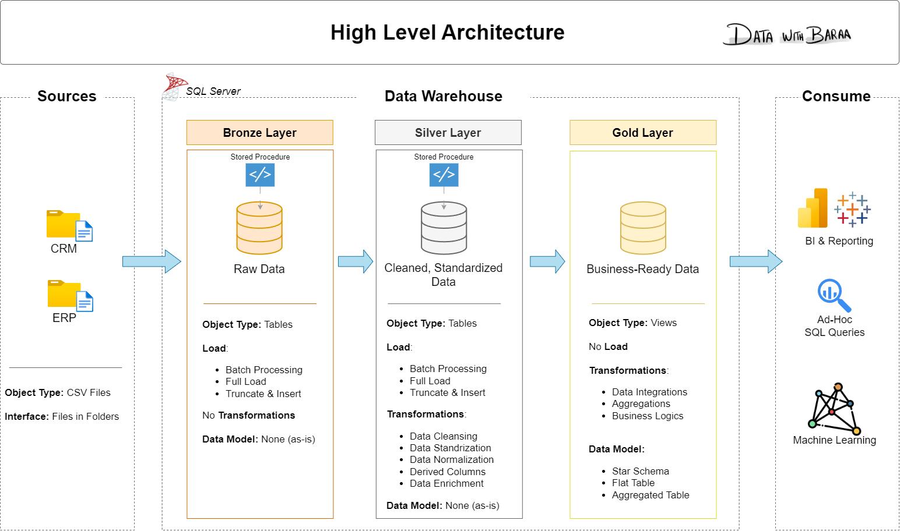
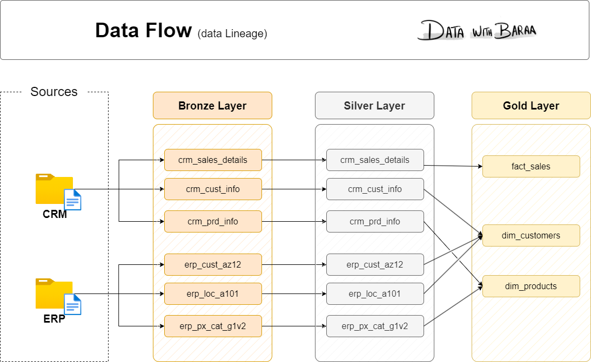
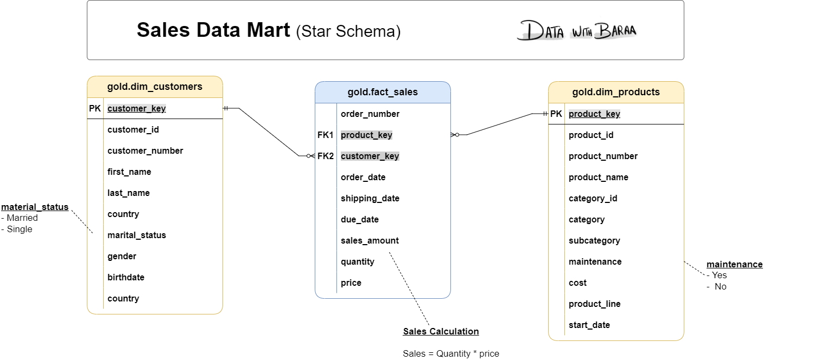

# SQL Data Warehouse (Medallion Architecture)

A SQL Server data warehouse that consolidates sales data from two source systems (CRM and ERP) into a star schema for analytics, using the **Bronze → Silver → Gold** medallion architecture.

> **Credit:** This is a learning project built while following [Data With Baraa's SQL Data Warehouse course](https://github.com/DataWithBaraa/sql-data-warehouse-project) (MIT licensed). The datasets, scripts and documentation here originate from that course; the original copyright notice is kept in [`LICENSE`](LICENSE). I am using it to learn how data warehouses are designed and built, and I am working through the layers myself.

## Architecture



| Layer | Purpose | What is in this repo |
|---|---|---|
| **Bronze** | Raw data, loaded as-is from the source CSV files | 6 tables + `bronze.load_bronze` stored procedure (`BULK INSERT`) |
| **Silver** | Cleaned, standardised and normalised data | 6 tables + `silver.load_silver` stored procedure |
| **Gold** | Business-ready star schema for reporting | 3 views: `gold.dim_customers`, `gold.dim_products`, `gold.fact_sales` |

**Sources:** CRM (`cust_info`, `prd_info`, `sales_details`) and ERP (`CUST_AZ12`, `LOC_A101`, `PX_CAT_G1V2`), provided as CSV files in `01_datasets/`.

## Data flow and model





## Repository structure

```
sql-data-warehouse-medallion/
├── 01_datasets/        # Source CSVs: source_crm/ and source_erp/
├── 02_docs/            # Architecture, data flow, data model, data catalog, naming conventions, requirements
├── 03_scripts/
│   ├── init_database.sql   # Creates the database and the bronze / silver / gold schemas
│   ├── bronze/             # DDL + load procedure (raw ingestion)
│   ├── silver/             # DDL + load procedure (cleansing and standardisation)
│   └── gold/               # Views forming the star schema
├── 04_tests/           # Data quality checks for the silver and gold layers
├── LICENSE
└── README.md
```

## How to run (SQL Server)

1. Install SQL Server Express and SQL Server Management Studio (SSMS).
2. Run `03_scripts/init_database.sql` (this creates the database and schemas; it drops and recreates the database if it already exists).
3. Run the DDL scripts in `bronze/`, then `silver/`, then `gold/`.
4. In `03_scripts/bronze/proc_load_bronze.sql`, change the `BULK INSERT` file paths to where `01_datasets/` is on your machine, then run `EXEC bronze.load_bronze;`
5. Run `EXEC silver.load_silver;`
6. Run the checks in `04_tests/` and query the `gold` views.

## Documentation

- [Data catalog](02_docs/data_catalog.md): tables, columns and descriptions of the gold layer
- [Naming conventions](02_docs/naming_conventions.md)
- [Project requirements](02_docs/requirements.md)

## Analytics goals

Customer behaviour, product performance and sales trends, queried from the gold layer.
